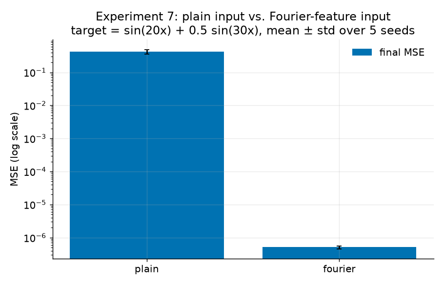

Worked on this project locally over the course of a couple of months, with the final commit made to publish it on GitHub.

# Investigating Spectral Bias in Neural Networks Through Fourier Analysis
Investigated how 24+ neural networks approximate 6 mathematical functions containing controlled low- and high-frequency components by tracking 12 Fourier coefficients of model predictions across 1,500 training iterations.


**Tools:** Python, NumPy, PyTorch, Matplotlib

## What This Project Is About

When a neural network learns a wavy function, does it learn the slow waves and the fast waves at the same speed?

It doesn't because a network picks up slow (low-frequency) patterns quickly and has a much harder time with fast (high-frequency) ones. Researchers call this **spectral bias**, so I reproduced that effect on simple functions and tested a few things that might help.

## How It Works

1. **Make a target function out of sine waves**, like `sin(x) + 0.5·sin(10x)`.
2. **Train a small neural network** to copy that function.
3. **Check in during training.** Randomly taking the network's current output and running a Fourier transform (FFT) on it to see how much of each frequency the network has learned so far.
4. **Compare to the right answer.** I count a frequency as "learned" once the network reaches 90% of its true size and repeated this with 5 different ransom seeds.

## What I Found

**Low frequencies are learned first.**
For `sin(x) + 0.5·sin(kx)`, the network always learned `sin(x)` quickly. The second wave got harder as `k` got bigger:

| Second frequency (k) | Runs that learned it (out of 5) |
|---|---|
| 2 | 5 |
| 5 | 3 |
| 10 | 0 |
| 20 | 0 |
| 30 | 0 |

**High-frequency targets have much higher error.**

| Target | Final error (MSE) |
|---|---|
| Low frequencies (1, 2) | 0.00006 |
| Mixed (1, 10) | 0.065 |
| High frequencies (20, 30) | 0.43 |

**Some things help a little.**
- Making the network wider (16 → 128 neurons per layer) cut the error about 3.3×.
- Sine activations did better than tanh and ReLU on average, but results varied a lot between seeds.

**One thing helps a lot.**
Instead of giving the network plain `x`, I gave it a list of sine and cosine waves (`sin(x), cos(x), sin(2x), …`). These are called **Fourier features**. On the high-frequency target, the error dropped from **0.43 to about 0.0000005**. Since target's frequencies were already in that list this was a best-case result.



## The Phase Correction
To make sure my FFT code was right, I also calculated the Fourier coefficients the slow way, by approximating the integrals directly. The two methods should give the same answers.

**What went wrong:** they didn't match. For odd frequencies (k = 1, 3, 5, …) the FFT gave the right size but the **wrong sign**. For example, it said `sin(x)` was `−sin(x)`.

**Why it happened:** the FFT assumes your data starts at **x = 0**. My data started at **x = −π**. So the FFT was effectively looking at my function shifted over by π.

Shifting a sine wave by π does this:

```
sin(k(x − π)) = (−1)^k · sin(kx)
```

- If k is **even**, (−1)^k = +1, so nothing changes.
- If k is **odd**, (−1)^k = −1, so the sign flips.

That's exactly the pattern I saw: even frequencies were fine and odd ones came out flipped.

**The fix:** I used a phase-correction formula from a textbook. It adjusts each FFT result for where the data actually starts. For my interval, it comes down to multiplying each coefficient by (−1)^k to undo the flip.

**Checking the fix:** after the correction, the FFT and the slow method agreed to within 0.0000000000000003, which is just computer rounding error.

## Avoiding Aliasing

If you don't sample a wave often enough, a fast wave can look like a slow one. This is called **aliasing**. I tested it by sampling `sin(30x)` at only 32 points, and the FFT reported it as `sin(2x)`. To avoid this in my real experiments, I used 512 evenly spaced points, which is enough to measure frequencies up to 256. My fastest target was 30, so there was plenty of room.

## Limitations

- I only used simple 1D functions and small networks.
- All targets were made of sine waves, so real-world data would be messier.
- This project reproduces a known result. It doesn't discover a new one.

## How to Run It

```bash
pip install numpy torch matplotlib
python experiments/run_all.py
```

This recreates every plot in `figures/` and every result file in `results/`.
